# Registro de la Conversación: Estudio de ApiEventos (Paso a Paso)

---

## Mensaje 1 — Usuario
> es prioridad absuta que ahorita veamos la practica de ApiEventos. necesito aprender que se hizo y como esta conformado. desde lo elemental y fundamental

---

## Respuesta 1 — Asistente

Vamos a desglosar la práctica **ApiEventos** desde lo más fundamental hasta cada línea importante de código.

---

### 1. ¿Qué es `ApiEventos` y qué problema resuelve?

Es una **API RESTful** construida sobre el ecosistema **Spring Boot** (Java) que gestiona una entidad de negocio llamada **`Evento`**.
Permite realizar las operaciones esenciales del ciclo de vida de los datos:
1. **CRUD completo**: Crear, Leer (todos o por ID), Actualizar y Eliminar eventos.
2. **Validación de entrada**: Evitar datos inválidos antes de tocar la base de datos (con Bean Validation).
3. **Manejo de códigos HTTP y errores**: Retornar respuestas claras (`200 OK`, `201 CREATED`, `204 NO CONTENT`, `400 BAD REQUEST`, `404 NOT FOUND`, `500 INTERNAL SERVER ERROR`).
4. **Utilerías de negocio reales**:
   - Generación de un reporte descargable en **PDF** (usando la librería **iText**).
   - Envío automático de **notificaciones por correo electrónico** (usando **JavaMailSender** de Spring).
5. **Documentación interactiva**: Interfaz de pruebas mediante **Swagger / OpenAPI**.

---

### 2. Arquitectura en Capas (El flujo elemental)

El proyecto sigue la arquitectura clásica en **3 capas más capa transversal**:

```mermaid
graph TD
    Client["Cliente (Postman / Browser / Angular)"] -->|Petición HTTP| Controller["EventoController (Capa Web / Presentación)"]
    Controller -->|Llama métodos de negocio| Service["EventoService / EventoServiceImpl (Lógica de Negocio)"]
    Service -->|Operaciones CRUD| Repo["EventoRepository (Capa de Acceso a Datos / JPA)"]
    Service -->|Notifica creación| Email["EmailService (Utilerías)"]
    Service -->|Genera reporte binario| PDF["iText PDF Generator"]
    Repo -->|SQL Automático| DB[("MySQL: GestionEventos7CM2")]
```



1. **Cliente**: Envía JSON mediante métodos HTTP (`GET`, `POST`, `PUT`, `DELETE`).
2. **Controlador (`EventoController.java`)**: Recibe la petición, valida la estructura del JSON (`@Valid`), atrapa excepciones de base de datos (`DataAccessException`) y devuelve el `ResponseEntity` con el código HTTP correspondiente.
3. **Servicio (`EventoServiceImpl.java`)**: Contiene la lógica, gestiona transacciones (`@Transactional`), orquesta el guardado y construye el documento PDF en memoria.
4. **Repositorio (`EventoRepository.java`)**: Interfaz que hereda de `JpaRepository`. **No requiere escribir SQL a mano**; Spring Data JPA genera las consultas automáticamente.
5. **Entidad (`Evento.java`)**: Representa la tabla `Evento` en MySQL.

---

### 3. Desglose Componente por Componente

#### A. La Configuración del Entorno (`application.properties`)

Define cómo se comunica la aplicación con MySQL, Swagger y Gmail:

- **Puerto:** `server.port=8080`.
- **Base de Datos:**
  - Base: `GestionEventos7CM2` en puerto `3306` (o configurable vía variable de entorno `${DB_PORT:3306}`).
  - `spring.jpa.hibernate.ddl-auto=update`: Hibernate crea o actualiza las tablas automáticamente al arrancar.
  - `PhysicalNamingStrategyStandardImpl`: Respeta el nombre de las columnas en camelCase (ej. `idEvento`, `nombreEvento`), evitando convertirlos a snake_case (`id_evento`).
- **Swagger:**
  - Ruta de UI: `/documentacion/swagger-ui.html`.
  - Rutas expuestas: `/api/v1/eventos/**`.
- **Servidor de Correo:**
  - Host SMTP de Gmail (`smtp.gmail.com`, puerto 587 con TLS).
  - Credenciales inyectadas de forma segura desde variables de entorno (`MAIL_USER`, `MAIL_PASSWORD`, `MAIL_TO`).

---

#### B. Capa de Dominio: `Evento.java`

Es la clase entidad que mapea con la base de datos:

```java
@AllArgsConstructor
@NoArgsConstructor
@Data // Lombok: genera getters, setters, toString, equals y hashCode
@Entity(name = "Evento")
public class Evento implements Serializable {

    @Id
    @GeneratedValue(strategy = GenerationType.IDENTITY)
    @Column(name = "idEvento")
    private Long idEvento;

    @NotBlank(message = "El nombre del evento no debe estar vacío")
    @Size(min = 4, max = 200, message = "El nombre del evento debe tener entre 4-200 caracteres")
    @Column(name = "nombreEvento", length = 200, nullable = false, unique = true)
    private String nombreEvento;

    @NotBlank(message = "La descripción del evento no debe estar vacía")
    @Size(min = 4, max = 500, message = "La descripción del evento debe tener entre 4-500 caracteres")
    @Column(name = "descripcionEvento", length = 500, nullable = false)
    private String descripcionEvento;

    @NotNull(message = "La fecha es obligatoria")
    @Column(name = "fechaCreacion", nullable = false)
    private LocalDate fechaCreacion;
}
```

**Conceptos clave aquí:**
- **JPA:** `@Entity`, `@Id`, `@GeneratedValue(IDENTITY)` (autoincrementable) y `@Column`.
- **Validaciones:** `@NotBlank` (no nulo, no cadenas de solo espacios), `@Size` (longitud mínima y máxima) y `@NotNull` (para tipos que no son texto, como `LocalDate`).

---

#### C. Capa de Persistencia: `EventoRepository.java`

```java
public interface EventoRepository extends JpaRepository<Evento, Long> {
}
```
Con solo extender `JpaRepository<Evento, Long>`, Spring proporciona de forma inmediata:
- `findAll()`, `findById(Long id)`, `save(Evento e)`, `deleteById(Long id)`.

---

#### D. Capa de Servicio: `EventoService.java` e `Impl`

Separa la interfaz del contrato de su implementación concreta.
- **Transacciones:**
  - `@Transactional(readOnly = true)` en lecturas para optimizar el rendimiento de la sesión de Hibernate.
  - `@Transactional` en inserciones o eliminaciones para garantizar atomicidad (todo se aplica o se hace rollback).
- **Generación de Reporte PDF (`generarReporte`):**
  - Usa la librería **iText** (`Document`, `PdfWriter`, `PdfPTable`, `PdfPCell`).
  - Dibuja el reporte completamente en un stream en memoria (`ByteArrayOutputStream`), por lo que no necesita escribir archivos temporales en el disco duro.
  - Retorna un `ByteArrayInputStream` listo para ser transmitido al navegador o cliente HTTP.

---

#### E. Capa de Utilerías: `EmailService` / `EmailServiceImpl`

- Inyecta `JavaMailSender`.
- Cuando se registra un evento nuevo, arma un `SimpleMailMessage` notificando el nombre y fecha del evento.
- **Manejo defensivo:** Si el correo no está configurado (`MAIL_TO` vacío) o falla el SMTP, atrapa el `MailException` registrando un log sin tumbar ni hacer fallar la creación del evento en la base de datos.

---

#### F. Capa Web: `EventoController.java`

Ruta base: `@RequestMapping("/api/v1/eventos")` con `@CrossOrigin(origins = {"http://localhost:4200"})` para permitir llamadas desde Angular.

Endpoints implementados:

| Método HTTP | Ruta | Qué hace | Código HTTP retornado |
|---|---|---|---|
| `GET` | `/api/v1/eventos` | Obtiene la lista completa de eventos | `200 OK` |
| `GET` | `/api/v1/eventos/{id}` | Busca un evento por ID | `200 OK` si existe, `404 NOT FOUND` si no, `500` si hay error en BD |
| `GET` | `/api/v1/eventos/pdf` | Descarga el PDF con la lista de eventos | `200 OK` (`application/pdf`) |
| `POST` | `/api/v1/eventos` | Valida, crea el evento y envía correo | `201 CREATED` si es exitoso, `400 BAD REQUEST` si falla validación, `500` si duplica nombre |
| `PUT` | `/api/v1/eventos/{id}` | Actualiza un evento existente | `200 OK`, `400` si validación falla, `404` si el ID no existe, `500` si error en BD |
| `DELETE` | `/api/v1/eventos/{id}` | Elimina el evento de la base de datos | `204 NO CONTENT` |

##### ¿Cómo funciona la validación en el Controller?
En los métodos `create` y `update`:
```java
public ResponseEntity<Map<String, Object>> create(
    @Valid @RequestBody Evento evento, 
    BindingResult result
) {
    if (result.hasErrors()) {
        List<String> errores = result.getFieldErrors()
            .stream()
            .map(err -> "El campo '" + err.getField() + "' " + err.getDefaultMessage())
            .collect(Collectors.toList());

        respuesta.put("errores", errores);
        return new ResponseEntity<>(respuesta, HttpStatus.BAD_REQUEST); // 400
    }
    // ...
}
```
1. `@Valid` dispara la comprobación de anotaciones de `Evento.java`.
2. Si alguna regla falla, Spring almacena los errores en el objeto `BindingResult`.
3. Si `result.hasErrors()` es verdadero, se devuelve un mapa con los mensajes de error y estado `400 BAD REQUEST`.

---

### 4. Flujo Paso a Paso de una Creación (`POST`)

Cuando ejecutas:
```bash
curl -X POST http://localhost:8080/api/v1/eventos \
  -H "Content-Type: application/json" \
  -d '{"nombreEvento":"Huawei Day","descripcionEvento":"Charla técnica","fechaCreacion":"2026-10-20"}'
```

1. **Recepción:** El Servlet Dispatcher de Spring mapea la URL `/api/v1/eventos` con `@PostMapping` en `EventoController`.
2. **Deserialización y Validación:** Transforma el JSON a un objeto `Evento`. Si el nombre tiene menos de 4 letras, `result.hasErrors()` lo frena con código 400.
3. **Persistencia:** Llama a `eventoService.save(evento)`.
4. **Inserción SQL:** `EventoRepository` ejecuta un `INSERT INTO Evento ...` y MySQL genera el `idEvento`.
5. **Notificación:** `emailService.enviarCorreo(eventoNuevo)` envía un email con los detalles.
6. **Respuesta:** Se emite JSON con `mensaje`, el `evento` recién persistido (ya con su `idEvento`) y código `201 CREATED`.

---

### 5. Puntos Clave que Suele Evaluar el Profesor

1. **¿Por qué `@CrossOrigin`?** Porque el frontend en Angular corre en un puerto distinto (`http://localhost:4200`) y el navegador bloquearía las peticiones por la política CORS si no estuviera habilitado.
2. **¿Por qué `BindingResult` debe ir inmediatamente después del objeto `@Valid`?** En Spring MVC, el argumento `BindingResult` debe seguir directamente al objeto validado en la firma del método para que pueda capturar sus errores específicos.
3. **¿Por qué `ByteArrayInputStream` para el PDF?** Porque permite transmitir el PDF generado directamente a través de HTTP (`InputStreamResource`) sin escribir archivos temporales en el disco del servidor.
4. **¿Qué hace `@Transactional(readOnly = true)`?** Informa al gestor de transacciones que solo se ejecutarán operaciones de lectura, permitiendo a Hibernate omitir el dirty-checking (comprobación de modificaciones en memoria), lo que optimiza la memoria y el tiempo de respuesta.

---

## Mensaje 2 — Usuario
> puedes ver los cambios que se hicieron porqe se trajo con pull, verdad?

---

## Respuesta 2 — Asistente

Sí, puedo ver el historial de Git completo. 

El repositorio está actualizado (`Your branch is up to date with 'origin/master'`) y los últimos commits que se integraron fueron:

1. **`9345014`**: *"Add explanatory comments to ApiEventos (C704), with origin of each piece from the classes"*:
   - Agregó comentarios en casi todos los archivos (`Evento.java`, `EventoController.java`, `EventoServiceImpl.java`, `application.properties`, etc.) marcando con etiquetas (`29sept`, `zip`, `clase del 7 oct`) de dónde viene exactamente cada ajuste o decisión.
2. **`4c3eec8`**: Ajustó el puerto a `8080` y dejó el manejo de errores del PDF tal como lo hizo el profesor en clase (`e.printStackTrace()`).
3. **`87e6811`**: Cuadró el reporte PDF con la clase (fuentes Courier 14 / Helvetica 10, encabezados en rojo sobre fondo cian, títulos de columnas).
4. **`ac9ec97`**: Alineó la ruta base a `/api/v1/eventos`, el código de retorno del `PUT` a `200 OK`, y movió el paquete de `utilerias` para que quedara dentro de `evento`.
5. **`e82e5dd`**: Registró la práctica en la agenda de tareas.

---

### ¿Cómo prefieres que continuemos estudiando?

Podemos abordarlo de tres formas:

1. **Código por código a fondo**: Ver archivo por archivo (`Evento.java`, `EventoController.java`, etc.) explicando qué hace cada anotación (`@Valid`, `@RequestBody`, `@Transactional`, etc.).
2. **Modo examen / preguntas y respuestas**: Te hago preguntas típicas que suele hacer el profesor sobre la práctica para evaluar tu comprensión.
3. **Arrancar y probar la API en vivo**: Levantar el servidor y hacer las peticiones con `curl` o ver Swagger para comprobar las respuestas y códigos HTTP.

---

## Mensaje 3 — Usuario
> emepecesmos de nuevo por el inicio 
> soy completamente nuevo en la materia y en java, no se nada

---

## Respuesta 3 — Asistente

Perfecto. Vamos a empezar **desde cero absoluto**. Sin tecnicismos raros sin explicar y con analogías sencillas de la vida real.

---

### Paso 0: ¿Qué es una API REST y para qué sirve?

Imagina un **restaurante**:
1. **El Cliente (Tú en la mesa)**: En programación, es una aplicación móvil, una página web en Angular o una herramienta como Postman. Quiere pedir algo o consultar información.
2. **El Mesero (La API REST)**: Recibe tu pedido en la mesa, lo lleva a la cocina y luego te trae la comida de vuelta. El cliente nunca entra a la cocina directamente.
3. **La Cocina / Despensa (La Base de Datos MySQL)**: Donde están guardados los ingredientes (los datos de los eventos).

Una **API REST** es ese mesero. Funciona mediante internet usando el protocolo **HTTP** con 4 acciones principales (conocidas como **CRUD**):

| Acción en la vida real | Nombre técnico (CRUD) | Verbo HTTP | Ejemplo en nuestra API |
| :--- | :--- | :--- | :--- |
| **Crear** un evento nuevo | **C**reate | `POST` | Mandas los datos de un evento nuevo para guardarlo. |
| **Consultar** o leer eventos | **R**ead | `GET` | Pides ver la lista de todos los eventos o uno en específico. |
| **Modificar** un evento | **U**pdate | `PUT` | Cambias el nombre o fecha de un evento que ya existe. |
| **Borrar** un evento | **D**elete | `DELETE` | Eliminas un evento por su número identificador (ID). |

El formato en el que hablan el cliente y el mesero es **JSON** (texto simple entre llaves `{}`):
```json
{
  "nombreEvento": "Conferencia de Inteligencia Artificial",
  "descripcionEvento": "Auditorio de la escuela",
  "fechaCreacion": "2026-10-20"
}
```

---

### Paso 1: ¿Qué es Spring Boot y qué son las "Anotaciones" (`@`)?

Java por sí solo puede ser muy tedioso de configurar. **Spring Boot** es un marco de trabajo (*framework*) que te ahorra miles de líneas de configuración aburrida.

En Spring Boot verás muchas palabras que empiezan con una arroba (`@`). Se llaman **Anotaciones**.
> **¿Qué es una anotación?**
> Es una etiqueta o "post-it" que le pegas a una clase o a una variable para decirle a Spring: *"Oye, haz magia con esto sin que yo tenga que programarlo a mano"*.

Ejemplos que veremos:
- `@Entity`: Le dice a Spring: *"Esta clase representa una tabla en MySQL"*.
- `@RestController`: Le dice a Spring: *"Esta clase va a recibir peticiones de internet"*.
- `@Autowired`: Le dice a Spring: *"Inyéctame aquí este componente ya listo, no quiero hacer `new` yo mismo"*.

---

### Paso 2: El mapa del proyecto (¿Cómo está organizado?)

Abre mentalmente la carpeta de la práctica: **ApiEventos**.

El código no está revuelto en un solo archivo; está dividido en **carpetas (llamadas "paquetes" en Java)**, cada una con una única responsabilidad:

```text
com.ipn.mx
 ├── ApiEventosApplication.java   <-- El botón de encendido de toda la app
 └── evento
      ├── domain                  <-- El Molde (¿Qué datos tiene un Evento?)
      ├── repository              <-- El Almacén (Habla directo con la base de datos)
      ├── service                 <-- El Cerebro (La lógica del negocio, PDF)
      ├── controller              <-- El Mostrador (Recibe y responde peticiones HTTP)
      └── utilerias               <-- Herramientas extra (Envío de correos)
```

---

### Paso 3: La primera pieza elemental — El Molde de Datos (`domain/Evento.java`)

Todo gira alrededor de una sola cosa: **un Evento**.
Vamos a ver el archivo real: `Evento.java`.

En Java, creamos una clase para definir qué campos tiene un evento:

```java
@Data
@Entity(name = "Evento")
public class Evento implements Serializable {

    @Id
    @GeneratedValue(strategy = GenerationType.IDENTITY)
    @Column(name = "idEvento")
    private Long idEvento;

    @NotBlank(message = "El nombre del evento no debe estar vacío")
    @Size(min = 4, max = 200, message = "El nombre del evento debe tener entre 4-200 caracteres")
    @Column(name = "nombreEvento", length = 200, nullable = false, unique = true)
    private String nombreEvento;

    @NotBlank(message = "La descripción del evento no debe estar vacía")
    @Size(min = 4, max = 500, message = "La descripción del evento debe tener entre 4-500 caracteres")
    @Column(name = "descripcionEvento", length = 500, nullable = false)
    private String descripcionEvento;

    @NotNull(message = "La fecha es obligatoria")
    @Column(name = "fechaCreacion", nullable = false)
    private LocalDate fechaCreacion;
}
```

Explicación sencilla de cada parte:

1. **`@Data` (de una herramienta llamada Lombok)**:
   - En Java tradicional, tendrías que escribir más de 50 líneas de código para funciones repetitivas llamadas `getIdEvento()`, `setIdEvento()`, etc.
   - `@Data` las genera en silencio en segundo plano. Te ahorra escribir código basura.

2. **`@Entity(name = "Evento")`**:
   - Le dice a la base de datos: *"Crea una tabla llamada `Evento` con estas columnas"*.

3. **`@Id` y `@GeneratedValue(strategy = GenerationType.IDENTITY)`**:
   - `idEvento` es la **llave primaria** (el identificador único de cada fila, como tu número de boleta).
   - `IDENTITY` significa **autoincrementable** (1, 2, 3, 4...). Tú no tienes que ponerlo, MySQL lo numera solo.

4. **Validaciones (`@NotBlank`, `@Size`, `@NotNull`)**:
   - Son las reglas del negocio:
     - El nombre no puede ser espacios vacíos (`@NotBlank`).
     - Debe medir entre 4 y 200 letras (`@Size(min = 4, max = 200)`).
     - La fecha es obligatoria (`@NotNull`).
   - Si alguien manda un evento con nombre `"A"`, Spring rechaza la petición antes de que toque la base de datos.

---

### Resumen del primer bloque

Hasta aquí ya conocemos:
1. Qué es una API REST (el mesero entre el cliente y la base de datos).
2. Los 4 verbos: `GET` (leer), `POST` (crear), `PUT` (actualizar), `DELETE` (borrar).
3. Qué es una anotación `@` (un post-it con instrucciones para Spring).
4. La clase `Evento.java`, que define qué datos guardamos y qué reglas deben cumplir.

---

## Mensaje 4 — Usuario
> [Muestra contenido de Evento.java líneas 33-71]
> un poco mas de detalle pero sigue

---

## Respuesta 4 — Asistente

Excelente. Vamos a profundizar con ese nivel de detalle en cada pieza, entendiendo el **por qué técnico** de cada línea.

---

### 1. Profundizando en `Evento.java`: Detalles que no debes pasar por alto

En las líneas que acabas de ver hay conceptos fundamentales de Java y bases de datos:

#### A. `implements Serializable` y `serialVersionUID` (Líneas 33 y 35)
```java
public class Evento implements Serializable {
    private static final long serialVersionUID = 1L;
```
- **¿Qué es la serialización en Java?**  
  Imagina que tienes un objeto en memoria RAM (`Evento`). Si necesitas transmitirlo por la red, guardarlo en un archivo o meterlo a una sesión, Java necesita **aplanar o descomponer** ese objeto en una secuencia de bytes (ceros y unos). A eso se le llama **serializar**.
- **`implements Serializable`**: Es una interfaz de Java que actúa como una "licencia". Le dice a la máquina virtual: *"Este objeto tiene permiso de convertirse en bytes y reconstruirse después"*.
- **`serialVersionUID = 1L`**: Es como el número de versión del molde. Si en el futuro agregas un campo a la clase, Java usa este identificador para saber si la versión de la clase que lee los bytes es compatible con la versión que los guardó.

---

#### B. El tipo `Long` frente a `long` primitivo (Línea 43)
```java
private Long idEvento;
```
- En Java existen dos tipos de enteros largos:
  - `long` (con minúscula): Es un tipo primitivo. **Siempre debe tener un número**; si no le das valor, por defecto vale `0`.
  - `Long` (con mayúscula): Es una clase envoltorio (*wrapper object*). **Puede valer `null`**.
- **¿Por qué usamos `Long` con mayúscula?**  
  Porque cuando el cliente nos manda un evento nuevo en formato JSON para crearlo, **el ID todavía no existe**. En la memoria el objeto nace con `idEvento = null`. Solo cuando MySQL lo guarda con `AUTO_INCREMENT`, le asigna su número (`1`, `2`, `3`...). Si fuera un `long` primitivo valdría `0` y causaría confusiones en la base de datos creyendo que ya tiene un ID.

---

#### C. `LocalDate` para las fechas (Línea 68)
```java
private LocalDate fechaCreacion;
```
- Antiguamente en Java se usaba `java.util.Date`, pero tenía muchos problemas con zonas horarias y horas no deseadas.
- `LocalDate` pertenece a la API moderna de Java (`java.time`). Solo guarda **Año-Mes-Día** (sin horas, minutos ni segundos).
- En el JSON de internet viaja como texto estándar ISO: `"2026-10-27"`. Spring Boot sabe convertir ese texto a `LocalDate` automáticamente.

---

#### D. La diferencia crucial: Validaciones de Java vs Restricciones de Base de Datos
Fíjate en las dos capas de seguridad que tiene el campo `nombreEvento`:

```java
@NotBlank(message = "El nombre del evento no debe estar vacío")
@Size(min = 4, max = 200, message = "El nombre del evento debe tener entre 4-200 caracteres")
@Column(name = "nombreEvento", length = 200, nullable = false, unique = true)
private String nombreEvento;
```

Hay **dos barreras defensivas**:

1. **Primera barrera (En Java / Memoria RAM)**:
   - `@NotBlank` y `@Size`: Se ejecutan en el servidor web apenas llega el JSON.
   - Si alguien manda un nombre vacío o de 2 letras, el código **frena la petición antes de hacer cualquier consulta a MySQL**, devolviendo un código `400 Bad Request`.
2. **Segunda barrera (En MySQL)**:
   - `@Column(length = 200, nullable = false, unique = true)`: Esto le dice a Hibernate cómo generar el código SQL en la base de datos:
     ```sql
     nombreEvento VARCHAR(200) NOT NULL UNIQUE
     ```
   - Si por algún motivo pasara la primera barrera e intentaras meter dos eventos con el mismo nombre (ejemplo: `"Expo ESCOM"` dos veces), **MySQL lanzará un error de clave duplicada**. En Java eso se traduce en una excepción `DataAccessException` y la API responderá con un error `500 Internal Server Error`.

---

### 2. La Capa de Acceso a Datos: `EventoRepository.java`

Veamos el archivo completo:

```java
package com.ipn.mx.evento.repository;

import com.ipn.mx.evento.domain.Evento;
import org.springframework.data.jpa.repository.JpaRepository;

public interface EventoRepository extends JpaRepository<Evento, Long> {

}
```

#### ¿Por qué este archivo está prácticamente vacío pero hace tanto?

1. **Es una `interface`, no una `class`**:
   - Una clase tiene código real entre llaves `{ ... }`.
   - Una interfaz solo define qué cosas se pueden hacer, pero no cómo se hacen.
2. **`extends JpaRepository<Evento, Long>`**:
   - Esto se lee: *"Hereda todo el poder de JpaRepository para gestionar la entidad `Evento`, cuya clave primaria es de tipo `Long`"*.
3. **¿Quién escribe el código SQL entonces?**
   - **Spring Data JPA** crea la implementación en tiempo de ejecución de forma invisible. Sin que tú escribas una sola línea, esta interfaz ya tiene métodos listos para usar:
     - `findAll()`: Ejecuta `SELECT * FROM Evento`.
     - `findById(Long id)`: Ejecuta `SELECT * FROM Evento WHERE idEvento = ?`.
     - `save(Evento evento)`: Si el objeto no tiene ID, ejecuta un `INSERT`. Si ya tiene ID, ejecuta un `UPDATE`.
     - `deleteById(Long id)`: Ejecuta `DELETE FROM Evento WHERE idEvento = ?`.

---

### 3. La Capa de Lógica de Negocio: Servicio (`EventoService.java` e `Impl`)

En proyectos profesionales y en las clases de tu profesor, la lógica de negocio se divide en **dos archivos**:

1. **La Interfaz (`EventoService.java`)**: El contrato. Define **qué** operaciones ofrece el sistema:
   ```java
   public interface EventoService {
       public List<Evento> findAll();
       public Evento findById(Long id);
       public Evento save(Evento evento);
       public void delete(Long id);
       public ByteArrayInputStream generarReporte(List<Evento> listaDeEventos);
   }
   ```
2. **La Implementación (`EventoServiceImpl.java`)**: El código real que ejecuta esas operaciones.

#### Las anotaciones clave en `EventoServiceImpl`:

```java
@Service
public class EventoServiceImpl implements EventoService {

    @Autowired
    private EventoRepository eventoRepository;
```

- **`@Service`**: Le dice a Spring: *"Esta clase es un componente de servicio; manéjala tú y tenla lista en memoria"*.
- **`@Autowired` (Inyección de dependencias)**:
  - En Java tradicional tendrías que haber hecho: `this.eventoRepository = new EventoRepositoryImpl();`.
  - Con `@Autowired`, **Spring busca automáticamente la instancia del repositorio y la conecta aquí**.

##### El manejo de transacciones con `@Transactional`:

```java
@Override
@Transactional(readOnly = true)
public List<Evento> findAll() {
    return eventoRepository.findAll();
}

@Override
@Transactional
public Evento save(Evento evento) {
    return eventoRepository.save(evento);
}
```

- **¿Qué es una transacción de base de datos?**
  Es un bloque de operaciones que debe cumplirse por completo o cancelarse por completo (*principio de todo o nada*).
- **`@Transactional(readOnly = true)` en lecturas**:
  Le avisa a Hibernate: *"Solo voy a consultar datos, no voy a modificar nada"*. Hibernate desactiva el monitoreo de cambios en memoria (*dirty-checking*), lo cual hace las consultas mucho más rápidas y ahorra memoria.
- **`@Transactional` en escrituras (`save`, `delete`)**:
  Garantiza que la operación se confirme (*commit*) si todo sale bien, o se revierta (*rollback*) si ocurre algún error a mitad del camino.

---

### 4. La Joya de la Práctica: Generación del PDF con iText en memoria

En `EventoServiceImpl.java` (líneas 57 a 110) está el método:

```java
public ByteArrayInputStream generarReporte(List<Evento> listaDeEventos)
```

#### ¿Cómo funciona la creación de un PDF sin guardarlo en el disco duro?

1. **Crear el lienzo en memoria RAM**:
   ```java
   Document documento = new Document();
   ByteArrayOutputStream salida = new ByteArrayOutputStream();
   PdfWriter.getInstance(documento, salida);
   documento.open();
   ```
   - En lugar de crear un archivo `reporte.pdf` en `C:\Archivos`, todo se escribe en un flujo de bytes en memoria (`ByteArrayOutputStream`).
2. **Definir tipografías y colores**:
   - Título en Courier tamaño 14, color Azul:
     ```java
     Font tipoLetra = FontFactory.getFont(FontFactory.COURIER, 14, BaseColor.BLUE);
     Paragraph parrafo = new Paragraph("Lista de eventos", tipoLetra);
     parrafo.setAlignment(Element.ALIGN_CENTER);
     documento.add(parrafo);
     ```
3. **Construir la tabla de 4 columnas**:
   ```java
   PdfPTable tabla = new PdfPTable(4);
   tabla.setWidthPercentage(100);
   ```
   - Los encabezados: *"Clave del evento"*, *"Nombre del evento"*, *"Descripción del evento"*, *"Fecha del evento"*, con texto en rojo sobre fondo cian:
     ```java
     encabezados.setBackgroundColor(BaseColor.CYAN);
     ```
4. **Llenar la tabla con los datos de la base de datos**:
   ```java
   for (Evento e : listaDeEventos) {
       tabla.addCell(new PdfPCell(new Phrase(String.valueOf(e.getIdEvento()), letraTexto)));
       tabla.addCell(new PdfPCell(new Phrase(String.valueOf(e.getNombreEvento()), letraTexto)));
       // ...
   }
   ```
5. **Cerrar y devolver los bytes**:
   ```java
   documento.close();
   return new ByteArrayInputStream(salida.toByteArray());
   ```
   Devuelve los bytes en forma de un `ByteArrayInputStream`, listo para que el controlador lo envíe como respuesta de descarga a quien lo pida.
